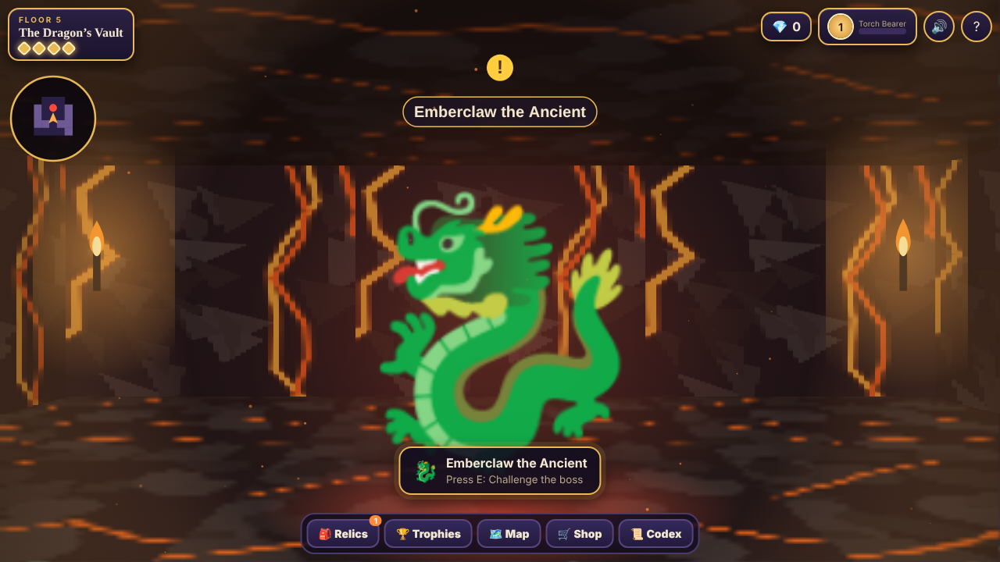
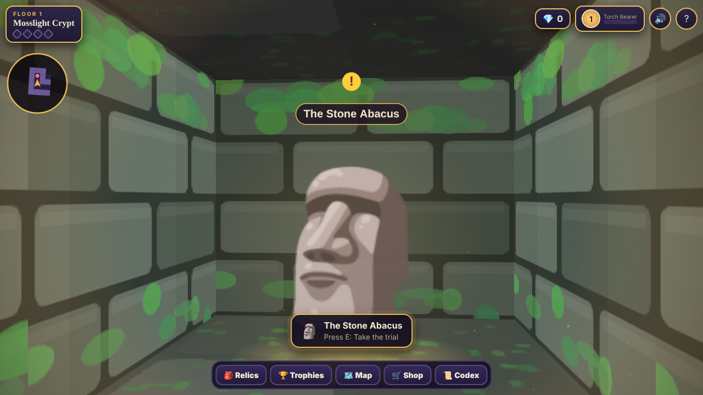
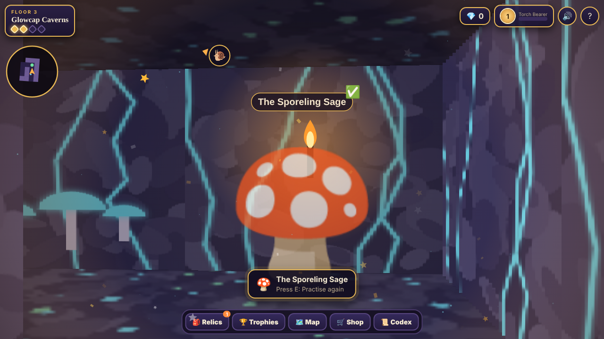
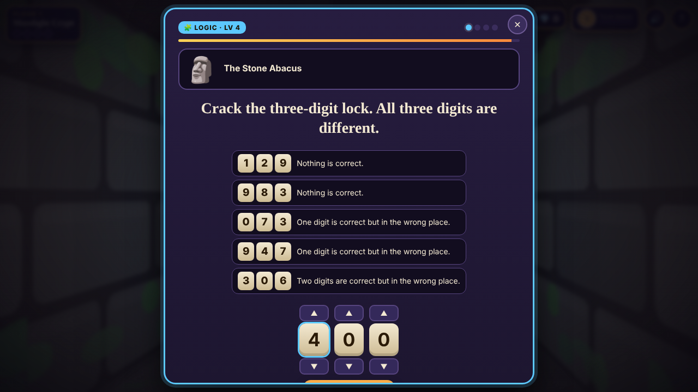
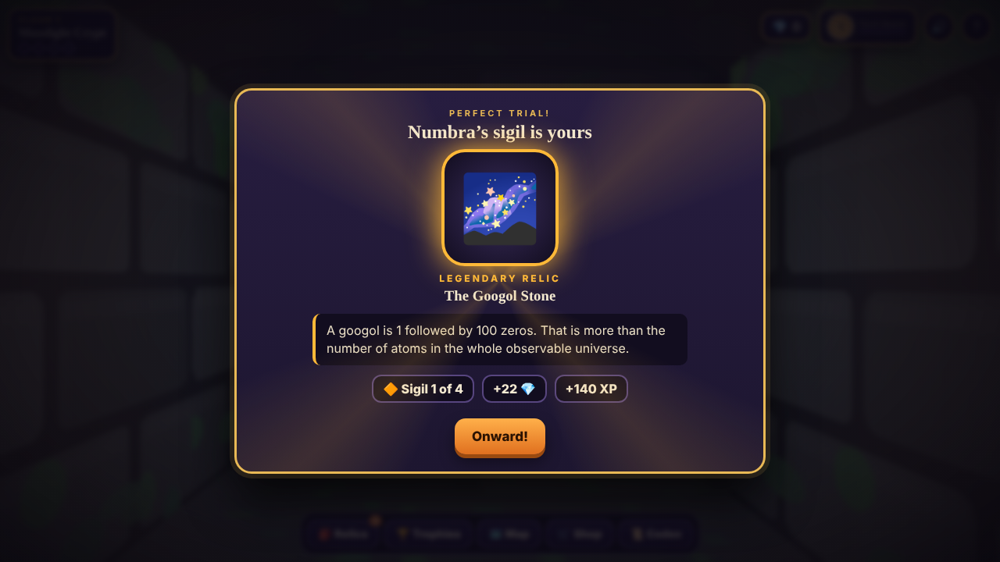

# Emberdeep: The Riddle Vaults

A first-person dungeon adventure for clever kids (roughly ages 8–11). Descend through five torch-lit floors, out-think the guardians, crack combination locks and secret codes, collect legendary relics, and face the dragon at the bottom.

Every challenge is a real question in maths, logic, science, or words and world knowledge, and the difficulty adapts to the player.

The whole game is a single HTML file. No install, no accounts, no ads, no tracking, and it works offline.

## Play

**Online:** `https://joelal447.github.io/emberdeep/` (once GitHub Pages is switched on, see below)

**Offline:** download `index.html` and open it in any modern browser.

## How it works

1. **Explore** a maze-like dungeon floor by torchlight. A compass arrow points to the next goal and a map fills in as you go.
2. **Take the guardians' trials.** Each floor has four guardians. Answer at least three of their four questions to win a sigil.
3. **Unseal the door.** Four sigils open the boss chamber.
4. **Beat the boss.** It has 6 health and you have 3 hearts. Fast first-try answers land critical hits, and the final blow is always a combination lock.
5. **Descend.** After the dragon, the dungeon begins again, deeper and harder.

| Floor | Subject |
|---|---|
| 1. Mosslight Crypt | Maths |
| 2. Cogwork Halls | Logic |
| 3. Glowcap Caverns | Science |
| 4. The Rune Library | Words & World |
| 5. The Dragon's Vault | Everything mixed |

| | |
|---|---|
|  |  |
|  |  |

## What players practise

Each subject has its own adaptive level from 1 to 6. It moves up after three first-try answers in a row and eases down after two misses in a row. Level 2 (the starting level) is aimed at roughly Year 5, and level 6 at roughly Year 8.

| Subject | Examples |
|---|---|
| Maths | Times tables, place value, Roman numerals, order of operations, fractions, percentages, area and volume, negative numbers, primes and factors, powers, the -illions, simple algebra, binary, probability |
| Logic | Number sequences, symbol equations, Caesar and mirror ciphers, Mastermind-style locks, analogies, odd one out, classic trick riddles |
| Science | Space, forces, the human body, materials and states of matter, rocks, ecosystems, chemistry basics, New Zealand wildlife |
| Words & World | Tricky spellings, anagrams, vocabulary, word roots, riddles, grammar, geography, te reo Māori |

Maths and many logic answers are typed on a number pad rather than picked from a list, so guessing doesn't work. Every question has a hint and an explanation.

## Things to collect

- **40 relics** in four rarities (common, rare, epic, legendary), each carrying a true fact
- **30 trophies** for streaks, speed, locks cracked, bosses beaten and more
- **15 rune stones** that fill a lore codex
- **Gems** to spend at the Goblin Market on lanterns, shield charms and four animal companions, each with a perk
- **XP levels** with ranks from Torch Bearer to Legend of Emberdeep

## Controls

| Action | Keyboard | Touch |
|---|---|---|
| Move | W A S D or arrow keys | Joystick |
| Look around | ← → or drag with the mouse | Drag the screen |
| Talk, open, read | E, or click | USE button, or tap |
| Jump | Space | JUMP button |
| Map | M | 🗺️ button |
| Answer | 1–4, number keys, Enter | Tap |

## Hosting on GitHub Pages

1. In the repository, go to **Settings → Pages**.
2. Under **Build and deployment**, choose **Deploy from a branch**, pick `main` and `/ (root)`, then **Save**.
3. After a minute or two the game is live at `https://joelal447.github.io/emberdeep/`.

## Privacy and saving

- Progress is saved only in the browser's local storage on the device being used. Nothing is sent anywhere.
- The only thing a player types is an adventurer name, which stays on the device.
- The game makes no network requests and loads no external fonts, scripts or images.
- Clearing browser data, or playing in a private window, resets progress.

## Technical notes

- One self-contained HTML file with inline CSS and JavaScript. No build step, no dependencies.
- Canvas 2D raycaster with textured walls, floors and ceilings, flickering torchlight, and procedurally generated mazes that are checked to be fully reachable.
- All textures are drawn in code at start-up; characters and relics use standard emoji, so they look slightly different on each device.
- Music and sound effects are generated with the Web Audio API.
- Rendering detail scales down automatically on slower devices.
- Respects the "reduce motion" setting and supports keyboard-only play.
- Tested in desktop Chrome at desktop, tablet and phone sizes.

## Credits

Made as a family project, built with help from Claude (Anthropic).

## Licence

No licence has been chosen yet, so all rights are reserved by default.
